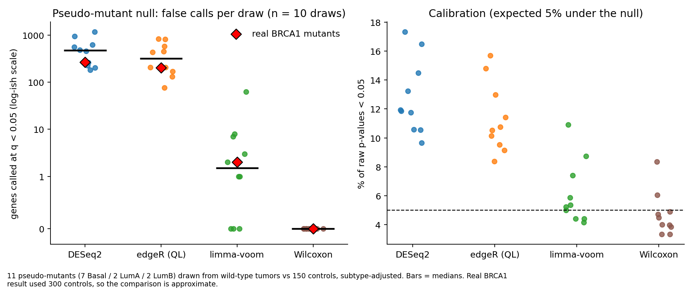
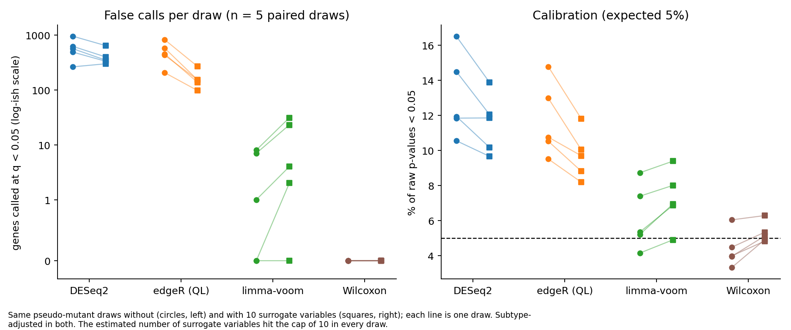
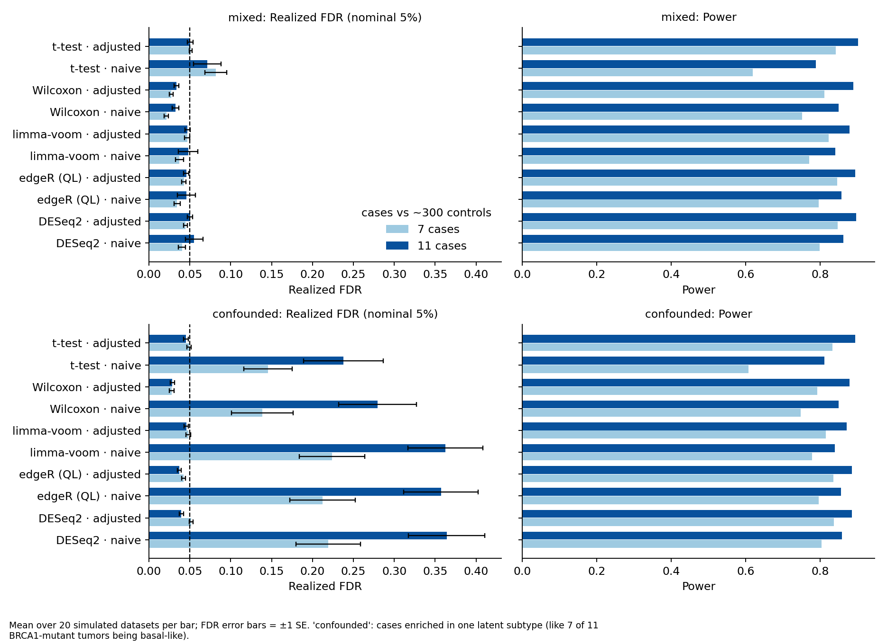
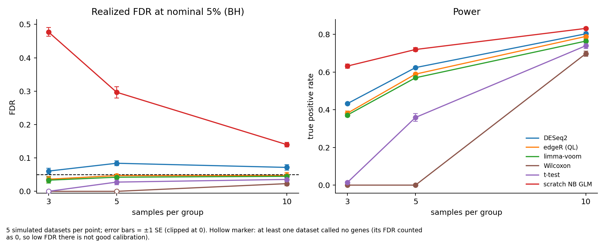
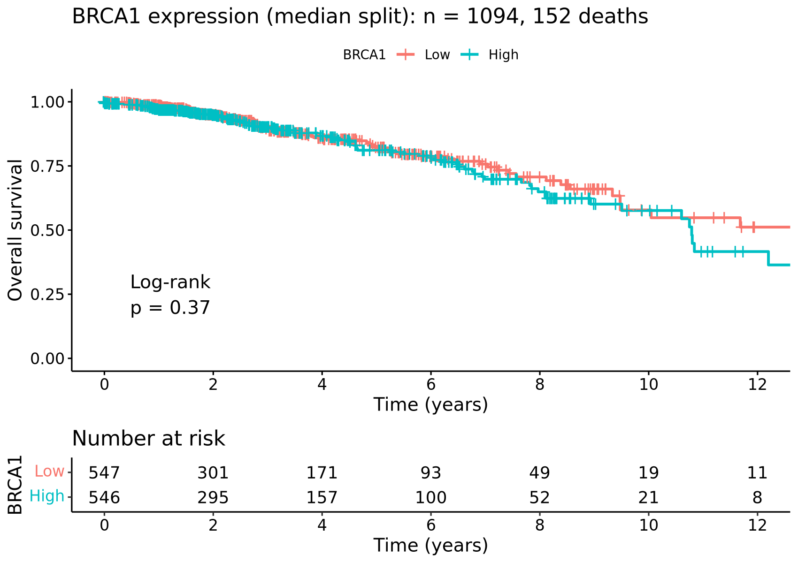

# Do differential-expression tools control the false discovery rate?

Simulation studies and a TCGA-BRCA case study (BRCA1/BRCA2 mutation, subtype confounding)

RNA-seq differential expression (DE) tools are used on thousands of genes at a time, with few replicates, and often on
groups that differ in more than the factor of interest. This project asks when DESeq2, edgeR and limma-voom can be trusted,
and answers it in three ways:

1. **Statistics from scratch:** Benjamini-Hochberg, a permutation test and a negative binomial GLM, validated against
   independent implementations.
2. **Simulation, where the truth is known:** balanced designs (3 to 10 samples per group) and an unbalanced, confounded design
   (7 or 11 cases against 300 controls, mimicking TCGA).
3. **Real data, where it is not:** TCGA-BRCA tumors (1,083 with subtype labels, 11 BRCA1-mutant and 7 BRCA2-mutant), with a
   permutation null built from the real expression data.

The full methods, tables and limitations are in [docs/methods_background.md](docs/methods_background.md).

## Main findings

- **Dispersion shrinkage is the reason the established tools work at small n.** A negative binomial GLM with the true
  dispersion has a 5% false-positive rate at every sample size, but with per-gene maximum-likelihood dispersion it reaches
  18.5% at 3 samples per group. The unshrunk scratch implementation had a realized FDR of 14% to 48% in the balanced
  simulation; DESeq2, edgeR and limma-voom stayed between 3% and 8% (DESeq2 slightly liberal, the other two slightly conservative).
- **Ignoring a confounder is far more damaging than the choice of tool.** In the confounded simulation, the naive design gave
  an FDR of 22% (7 cases) to 36% (11 cases) for the negative-binomial tools; adding the confounder to the model brought it back to
  4% to 5%. With no confounding, adjusting cost nothing.
- **In TCGA-BRCA, most of the "BRCA1 mutation signature" is tumor subtype.** Seven of the 11 BRCA1-mutant tumors are basal-like,
  against 18% of the cohort. The naive DESeq2 comparison called 2,210 genes; after adjusting for subtype it called 264, and no
  gene was called by all three tools.
- **On real data, the negative-binomial tools produce many false positives in this design.** When the real mutants were replaced
  by random "pseudo-mutants" with the same subtype mix (10 draws), DESeq2 called 513 genes on average and edgeR 389, in every
  draw. limma-voom called 8 on average and a Wilcoxon rank-sum test called none. The real BRCA1 result (264, 202, 2 and 0 genes)
  lies inside these null ranges, so it cannot be distinguished from noise. This did not appear in the clean simulation, and its
  cause is only partly explained (next point).
- **Surrogate variables reduce the false calls but do not remove them.** Rerunning five of the null draws with 10 surrogate
  variables cut edgeR's mean false calls from 497 to 161 and DESeq2's from 575 to 402, but raw p-values stayed at about twice the
  expected rate (9.7% and 11.5%), and limma-voom and Wilcoxon became slightly worse. The variables correlate loosely with immune
  (PTPRC), proliferation (MKI67) and epithelial (KRT19) markers. Hidden structure explains part of the problem, not all of it.
- **No expression effect of BRCA1/2 somatic mutation was detectable at this sample size.** The Wilcoxon test is calibrated on the
  null and called 14,698 genes in a strong positive control (100 basal vs 100 LumA tumors), yet it found nothing in 7 to 18
  mutants. That limits the claim to "no effect detectable with these numbers", not "no effect".
- **Survival:** in a Cox model with 1,036 patients and 144 deaths, age was the only clear predictor (hazard ratio 1.038 per year).
  BRCA1 expression was inconclusive (HR 1.15, 95% CI 0.96 to 1.38).

## Figures







## Repository layout

```
src/scratch/        Benjamini-Hochberg, permutation test, NB GLM (IRLS)
tests/              validation of the from-scratch code (10 tests)
simulation/         balanced and unbalanced simulators, Python and R methods, evaluation, figures
tcga/               TCGA-BRCA download, clinical fix, DE, permutation null, Wilcoxon check, survival
docs/               methods, results and limitations
workflow/ config/    stage-level Snakemake workflow and its parameters
results/            summary tables and figures (large intermediate files are git-ignored)
environment.yml     conda environment (Python and R)
```

## Reproducing the analysis

```
conda env create -f environment.yml && conda activate de-fdr-tcga-brca
pytest -q tests/
python simulation/simulate.py --reps 5 --n_genes 3000
python simulation/run_python_methods.py results/sim
Rscript simulation/run_r_methods.R results/sim
python simulation/evaluate.py results/sim
Rscript tcga/01_download_prepare.R     # about 5 GB from the GDC; includes follow-up times for living patients
Rscript tcga/02_confounded_de.R
```

`tcga/01b_fix_clinical.R` is only needed to repair an object built with an earlier version of step 1 (it adds follow-up
times for living patients); a fresh run of step 1 does not need it.

The remaining steps (unbalanced simulation, permutation null, Wilcoxon check, survival, figures) are listed in
[docs/methods_background.md](docs/methods_background.md#12-reproducibility). The permutation null takes about 5 minutes per
draw on 8 GB of RAM with the default of 150 controls.

## Running it with Snakemake

A stage-level Snakemake workflow (`workflow/Snakefile`, parameters in `config/config.yaml`) wraps the scripts, so each rule
calls one existing script on a whole folder. From the repository root, inside the conda environment:

```
snakemake -n                  # dry run: shows what would run
snakemake -c1                 # simulations, evaluation and figures (default target)
snakemake -c1 tcga_all        # TCGA-BRCA analysis; needs data/tcga/brca_se.rds
```

- Use `-c1`: the R jobs need a few GB of RAM each.
- The TCGA download (about 5 GB) is never run unless you allow it: `--config allow_download=true`. Otherwise a missing
  `data/tcga/brca_se.rds` stops the workflow with instructions.
- Existing results count as up to date, so a finished checkout reports "Nothing to be done". The slow, resumable stages write a
  `.done` flag, so a failed run keeps its finished datasets and a rerun skips them.
- A quick from-scratch test, in a clean copy of the repository (without `results/` and `data/`):
  `snakemake -c1 --configfile config/config_small.yaml`. It uses tiny settings, so its numbers are not meaningful. This runs
  the whole default target in about two minutes. The TCGA rules were checked with dry runs against the existing results and
  have not been rebuilt from scratch through the workflow.
- The workflow is stage-level: Snakemake cannot rerun a single simulated dataset, because the scripts loop over datasets
  themselves. A per-dataset version would need the scripts to accept one dataset at a time.

## Limitations

- Open-access TCGA data contains **somatic mutations only**; germline carriers (controlled access) are missing, and some
  "wild-type" tumors may be functionally BRCA-deficient.
- With 11 and 7 mutants, power is low. A lack of calls does not show a lack of effect.
- The simulations draw from a negative binomial model and use true effects of at least 0.6 log2 in 10% of genes, so their power
  figures do not transfer to real BRCA effects.
- The real-data inflation in DESeq2 and edgeR is only **partly explained**: ten surrogate variables reduced it (edgeR by about two
  thirds, DESeq2 by about 30%) but did not remove it. Outliers were not examined.
- Replicate counts are modest (5 balanced and 20 unbalanced simulated datasets per cell, 10 permutation draws).

## Status

Done: the from-scratch statistics, both simulations, the TCGA-BRCA analysis, the permutation null, the Wilcoxon check, the
survival analysis and a surrogate-variable test of the real-data inflation (without a completed real-mutant comparison).
A stage-level Snakemake workflow wraps all of the above.
Not done: a per-dataset Snakemake workflow, and the other projects in the original plan (single-cell, mini-GWAS).

## Two bugs worth knowing about

- **Normalization.** The t-test and Wilcoxon were first run on library-size-normalized log-CPM and looked inflated (Wilcoxon FDR of
  0.19 in one scenario). Median-of-ratios size factors brought it to 0.034 with unchanged power.
- **Silent data loss in the survival analysis.** The first Cox model reported 144 patients and 143 deaths out of 1,095 tumors,
  meaning patients who were alive had been dropped. Follow-up times are stored in a different GDC field than the one first
  queried. Fixing the query gave 1,036 patients and 144 deaths, and the BRCA1 hazard ratio changed from 0.88 to 1.15.
